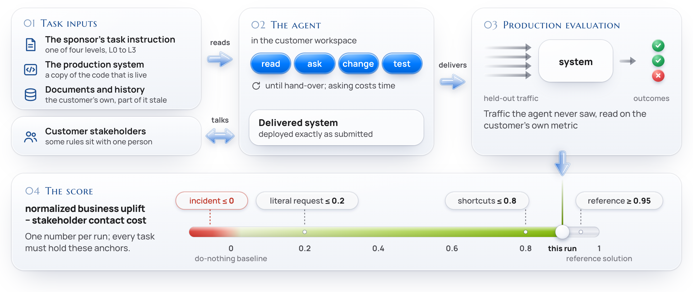

# FDE-Gym：客户说不清问题时，Agent 能否交付真正有用的改动

英文标题：FDE-Gym: The Last Mile of AI Delivery。作者：Yang, Dongxu、Yan, Hongda、Wang, Renxin、Zhang, Baoli、Zuo, Haojia、Zhao, Ying、Chen, Youmin、Liao, Xiaojian、Gao, Congming、Jiang, Tianyang、Chen, Yixiao、Wang, Qing、Yu, Zhiguo、Li, Xiaqing、Zhang, Yuhao、Sun, Jiawen、Xu, Renzhe、Mi, De、Wu, Tiancheng、Fu, Xianya、Zhao, Xuanlu、Feng, Bo、Ren, Meixuan、Lin, Guanming、Zhou, Ziheng、Wang, Xinhua。原始提交：2026-10-15，版本 v1。未确认正式录用，按预印本处理。

[arXiv 原始记录](https://arxiv.org/abs/2610.22350) · [原文 PDF](https://arxiv.org/pdf/2610.22350v1)。许可：CC BY 4.0。[站内原文 PDF](2610.22350v1.pdf)。

FDE-Gym 把任务放进已有客户系统：Agent 需要询问脚本化利益相关者、理解旧代码与数据，并通过原有入口交付修改。20个场景扩成95个任务；信息从L0的完整问题与约束，逐步减少到L3可能误导的客户请求。它测的是发现问题和兑现业务目标，不只是实现一句明确规格。

评分以不修改为0、参考实现为1来归一化业务收益；出现事故会截断正收益，还要扣除沟通成本，所以得分不是通过率。13种配置在152个任务与信息层级组合上各运行三次，预算限制为200轮、150分钟及8美元。L3最高均分约0.56，但达到高收益且无事故的任务仍只有少部分；不能把0.56写成解决56%的任务。

作者 fig4 原图，CC BY 4.0，保留完整图。图中隐藏信息和结果检查属于评测设计，不是 Agent 在一开始就能看到的标准答案（[来源原图](https://arxiv.org/abs/2610.22350)；[查看原尺寸](../../../frontiers/2026/10/2026-10-17/images/fde-gym.png)。）

为什么现在值得看：**新近实用；已读任务构造、评分、预算与结果，作者实验，本站未运行，热度待验证**。它提醒开发者把“做完请求”和“改善真实目标”分开。当前没有人类基线；仅3个样例公开，更多场景需申请，75个变体和参考实现保留作测试，不能宣称全量可直接复现。

[返回本期论文精选](../../../frontiers/2026/10/2026-10-17/03-论文精选.md)。
